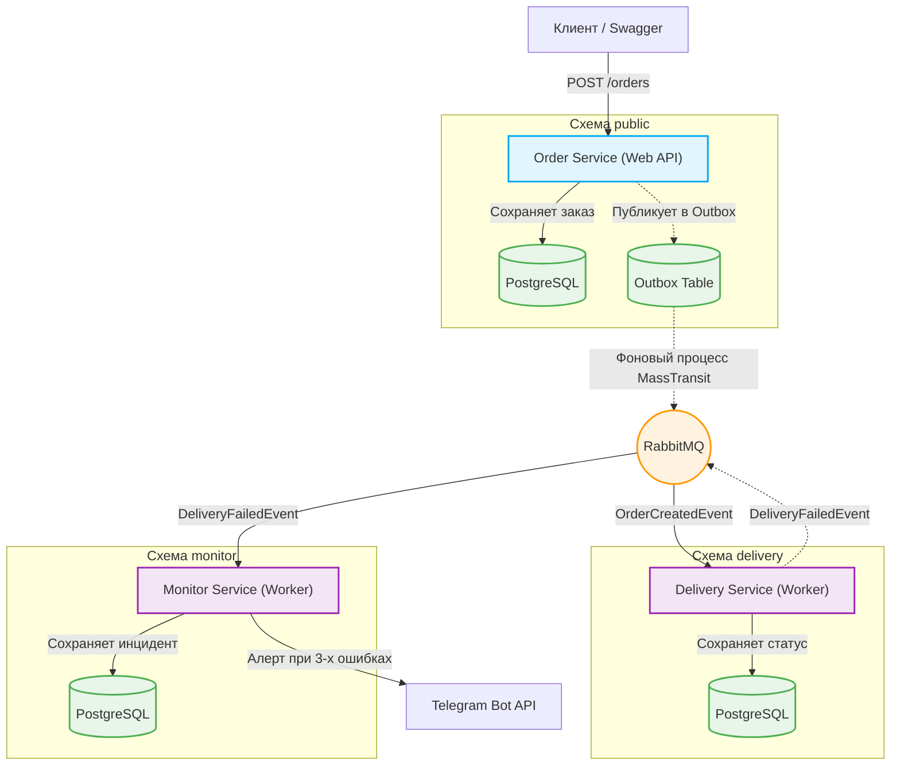

# SafeRoute

[](https://github.com/boblicon33/SafeRoute/actions/workflows/ci.yml)
[](https://dotnet.microsoft.com/)
[](https://www.docker.com/)

Это пет-проект, демонстрирующий архитектуру микросервисов с гарантированной доставкой событий (Transactional Outbox) и системой мониторинга отказов.

## 🏗 Архитектура



Система состоит из трех независимых микросервисов, общающихся асинхронно через брокер сообщений:

1. **Order Service (Web API)**: Принимает заказы, сохраняет их в базу данных и публикует событие `OrderCreatedEvent`.
2. **Delivery Service (Worker)**: Слушает очередь, имитирует обработку доставки (специально падает на каждом N-м заказе для тестирования отказоустойчивости) и публикует событие `DeliveryFailedEvent`.
3. **Monitor Service (Worker)**: Слушает события падений. Если количество ошибок подряд превышает порог, отправляет уведомление в **Telegram** и фиксирует инцидент в базе.

### Технологии:
* **.NET 10** (ASP.NET Core Minimal API, Worker Services)
* **PostgreSQL** (EF Core, Database per Service через схемы `public`, `delivery`, `monitor`)
* **RabbitMQ** (MassTransit v8)
* **Docker & Docker Compose** (мультистейдж сборка, healthchecks)
* **Testcontainers + xUnit** (интеграционные тесты)
* **GitHub Actions** (CI/CD)

## 🛡 Ключевые архитектурные решения

*   **Transactional Outbox (MassTransit EF Outbox)**: Гарантирует, что событие не потеряется, если сервис упадет между сохранением в БД и отправкой в RabbitMQ. Заказ и событие сохраняются в одной транзакции.
*   **Database per Service**: У каждого сервиса своя логическая схема в БД, что исключает связность на уровне данных.
*   **Асинхронная коммуникация**: Сервисы не знают друг о друге напрямую, взаимодействие идет через события.
*   **Health Checks**: Каждый сервис имеет эндпоинт `/health` для проверки доступности БД и брокера (готовность к работе в Kubernetes/Docker Swarm).

## 🚀 Как запустить проект

Для запуска потребуется только установленный **Docker Desktop**.

1. Клонируйте репозиторий и перейдите в папку проекта:
```bash
   git clone https://github.com/boblicon33/SafeRoute.git
   cd SafeRoute
```
2. Запустите проект одной командой:
```bash
   docker compose -f infra/docker-compose.yml up -d --build
```
3. Дождитесь сборки контейнеров (займет минуту).

🔗 Доступные сервисы после запуска:

Swagger (Order Service): http://localhost:5057/swagger

Health Check (Order): http://localhost:5057/health

Health Check (Delivery): http://localhost:5001/health

Health Check (Monitor): http://localhost:5002/health

RabbitMQ Management UI: http://localhost:15672 (guest / guest)

## 🧪 Как проверить работу системы
1. Откройте Swagger по ссылке выше.
2. Отправьте POST /orders с телом { "productName": "iPhone", "quantity": 1 }.
3. Первые 3 заказа будут успешно обработаны. Создайте 4-й и 5-й заказы.
4. Посмотрите в логи Monitor Service:
   ```bash
   docker logs saferoute-monitor-service
   ```

В проекте настроены интеграционные тесты, которые поднимают БД в Docker во время тестов.

Запуск тестов локально:
```bash
dotnet test tests/SafeRoute.OrderService.Tests/SafeRoute.OrderService.Tests.csproj
```